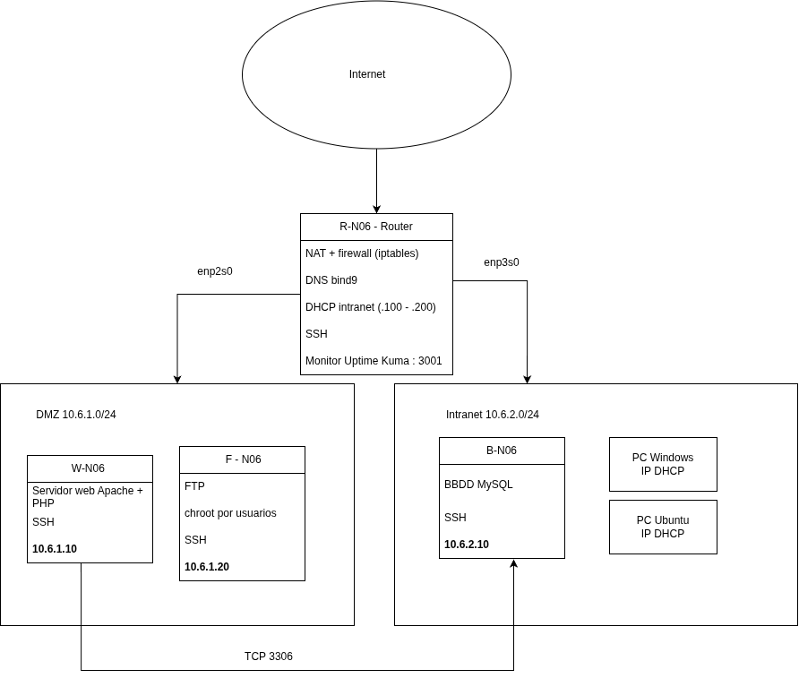

# P0.0-ASIXc2gC-G06 — Despliegue de Infraestructura Multicapa

Proyecto **módulo 0379**. Despliegue de una infraestructura de red y aplicación multicapa en **NuvuletVDI**: Router con NAT/Firewall, Servidor Web (PHP/Apache), Base de Datos MySQL (con dataset CSV OpenData Barcelona), Servidor FTP, Monitor de Red (Uptime Kuma), DNS, DHCP y acceso unificado por SSH.

---

## Equipo 06

| Persona | Responsabilidad Principal |
|---|---|
| **Aman** | Router `R-N06` (NAT, Firewall, DNS Bind9, DHCP, Uptime Kuma) y clientes |
| **Alex** | Base de Datos `B-N06` (MySQL e importación CSV) y Servidor FTP `F-N06` |
| **Jheremy** | Servidor Web `W-N06` (Apache + App PHP), Git, Documentación y Diagrama |
| **Todos** | Usuario `bchecker` y SSH en sus máquinas, gestión de tareas en ProofHub (`P0.0-ASIXc2C-G06`) |

---

## Arquitectura de Máquinas y Redes

| Hostname | Rol / Servicios | Zona de Red | Dirección IP / Rango |
|---|---|---|---|
| **R-N06** | Router, NAT, Firewall, DNS (`bind9`), DHCP, Uptime Kuma | NAT / DMZ / Intranet | IP NuvuletVDI / `10.6.1.1` / `10.6.2.1` |
| **W-N06** | Servidor Web (Apache + PHP) | DMZ | `10.6.1.10` |
| **F-N06** | Servidor FTP (`vsftpd` con chroot) | DMZ | `10.6.1.20` |
| **B-N06** | Base de Datos MySQL | Intranet | `10.6.2.10` |

- **Dominio interno:** `g06.lan`
- **Credenciales comunes de administración:** `bchecker` / `bchecker121`

### Diagrama de Red



---

## Índice de Documentación

Toda la documentación está organizada de forma compacta (un archivo `.md` por máquina) junto con la documentación transversal exigida por la rúbrica de evaluación:

### Documentación por Máquina
- [Máquina R-N06 (Router, NAT, Firewall, DNS, DHCP y Uptime Kuma)](docs/01-r-n06.md)
- [Máquina W-N06 (Servidor Web Apache, PHP y Aplicación Web)](docs/02-w-n06.md)
- [Máquina F-N06 (Servidor FTP VSFTPD y Chroot)](docs/03-f-n06.md)
- [Máquina B-N06 (Base de Datos MySQL y Dataset OpenData CSV)](docs/04-b-n06.md)
- [Clientes (Validación en Clientes Linux y Windows)](docs/05-clientes.md)

### Gestión Transversal y Rúbrica de Evaluación (`docs/00-global/`)
- [01. Arquitectura, Direccionamiento IP, SSH y Git PAT](docs/00-global/01-arquitectura-git.md)
- [02. Estudio Previo de Mercado y Prevención de Riesgos / PRL](docs/00-global/02-estudi-riscos.md)
- [03. Planificación por Sprints y Seguimiento en ProofHub](docs/00-global/03-sprints-backlog.md)
- [04. Criterios de Rendimiento, Disponibilidad y Juego de Pruebas](docs/00-global/04-proves-rendiment.md)
- [05. Manual de Usuario / Cliente](docs/00-global/05-manual-client.md)
- [06. Manual del Administrador y Mantenimiento](docs/00-global/06-manual-admin.md)

---

## Estructura del Repositorio

```text
.
├── README.md                          # Visión general del proyecto e índice
├── .gitignore                         # Archivos excluidos del control de versiones
├── app/                               # Código fuente de la aplicación Web (PHP)
│   ├── db.php
│   ├── index.php
│   └── style.css
├── config/                            # Archivos de configuración reales extraídos de las máquinas
│   ├── b-n06/                         # mysqld.cnf.fragmento, ufw-reglas.txt, usuarios.sql
│   ├── f-n06/                         # vsftpd.conf
│   ├── r-n06/                         # netplan, iptables, named.conf, dhcpd.conf
│   └── w-n06/                         # netplan, 000-default.conf
├── docs/                              # Documentación técnica en Markdown e imágenes
│   ├── img/                           # Diagrama de arquitectura y evidencias visuales (.png)
│   │   └── diagrama.png
│   ├── 00-global/                     # Entregables transversales exigidos por rúbrica
│   │   ├── 01-arquitectura-git.md
│   │   ├── 02-estudi-riscos.md
│   │   ├── 03-sprints-backlog.md
│   │   ├── 04-proves-rendiment.md
│   │   ├── 05-manual-client.md
│   │   └── 06-manual-admin.md
│   ├── 01-r-n06.md                    # Documentación unificada del Router R-N06
│   ├── 02-w-n06.md                    # Documentación unificada del Servidor Web W-N06
│   ├── 03-f-n06.md                    # Documentación unificada del Servidor FTP F-N06
│   ├── 04-b-n06.md                    # Documentación unificada de la Base de Datos B-N06
│   └── 05-clientes.md                 # Documentación unificada de Clientes
└── scripts/                           # Scripts Bash y Python de automatización
    ├── crear_bchecker.sh
    └── import_csv.py
