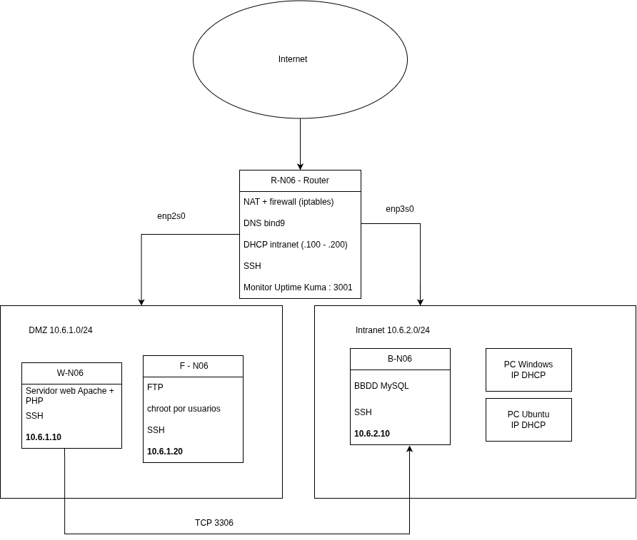

# P0.0-ASIXc2gC-G06 — Despliegue de Infraestructura Multicapa

Proyecto módulo 0379. Despliegue de una infraestructura de red y aplicación multicapa en **NuvuletVDI**: Router con NAT/Firewall, Servidor Web (PHP/Apache), Base de Datos MySQL (con dataset CSV OpenData Barcelona), Servidor FTP, Monitor de Red (Uptime Kuma), DNS, DHCP y acceso unificado por SSH.

---

## Equipo 06

| Persona | Responsabilidad Principal |
|---|---|
| **Aman** | Router `R-N06` (NAT, Firewall, DNS Bind9, DHCP, Uptime Kuma) |
| **Alex** | Base de Datos `B-N06` (MySQL e importación CSV) y Servidor FTP `F-N06` |
| **Jheremy** | Servidor Web `W-N06` (Apache + App PHP), Git, Documentación y Diagrama |
| **Todos** | Usuario `bchecker` y SSH en sus máquinas, gestión de tareas en ProofHub |

---

## Arquitectura de Máquinas y Redes

| Hostname | Rol / Servicios | Zona de Red | Dirección IP / Rango |
|---|---|---|---|
| **R-N06** | Router, NAT, Firewall, DNS (`bind9`), DHCP, Uptime Kuma | NAT / DMZ / Intranet | IP NuvuletVDI / `10.6.1.1` / `10.6.2.1` |
| **W-N06** | Servidor Web (Apache + PHP) | DMZ | `10.6.1.10` |
| **F-N06** | Servidor FTP (`vsftpd` con chroot) | DMZ | `10.6.1.20` |
| **B-N06** | Base de Datos MySQL | Intranet | `10.6.2.10` |

* **Dominio interno:** `g06.lan`
* **Credenciales comunes de administración:** `bchecker` / `bchecker121`

### Diagrama de Red



---

## Índice de Documentación

Toda la documentación está categorizada según la máquina correspondiente del proyecto y los requerimientos transversales de la práctica:

### Máquina R-N06 (Router & Servicios de Red)
* [Netplan, NAT y Firewall (iptables/nftables)](docs/01-r-n06/01-red-firewall.md)
* [DNS (Bind9) y Servidor DHCP](docs/01-r-n06/02-dns-dhcp.md)
* [Monitor de Red (Uptime Kuma en puerto 3001)](docs/01-r-n06/03-monitor.md)

### Máquina W-N06 (Servidor Web)
* [Apache, PHP y Despliegue de Aplicación Web](docs/02-w-n06/01-web-app.md)

### Máquina F-N06 (Servidor FTP)
* [Servicio VSFTPD y Configuración de Chroot](docs/03-f-n06/01-ftp.md)

### Máquina B-N06 (Base de Datos)
* [MySQL, Esquema de Datos e Importación de CSV](docs/04-b-n06/01-mysql.md)

### Gestión Transversal y Proyecto
* [Diagrama y Diseño de Arquitectura de Red](docs/00-global/00-arquitectura.md)
* [Acceso SSH y Usuario `bchecker`](docs/00-global/01-ssh-usuarios.md)
* [Control de Versiones (Git, SSH Keys y Workflow)](docs/00-global/02-git-despliegue.md)
* [Plan de Pruebas e Integración del Sistema](docs/00-global/03-pruebas.md)
* [Backlog, Sprints y Tareas de ProofHub](docs/00-global/backlog.md)

---

## Estructura del Repositorio

```text
.
├── README.md
├── docs/                     # Documentación modular organizada por máquina
│   ├── diagrama.png          # Esquema y arquitectura gráfica de la red
│   ├── 01-r-n06/             # Router, NAT, Firewall, DNS, DHCP, Uptime Kuma
│   ├── 02-w-n06/             # Servidor Web Apache + App PHP
│   ├── 03-f-n06/             # Servidor VSFTPD
│   ├── 04-b-n06/             # Base de Datos MySQL y CSV
│   └── 00-global/            # Arquitectura, SSH, Git, Pruebas y ProofHub
├── config/                   # Archivos de configuración de cada servidor
│   ├── r-n06/
│   ├── w-n06/
│   ├── f-n06/
│   └── b-n06/
├── app/                      # Código fuente de la aplicación Web (PHP)
└── scripts/                  # Scripts de creación de usuario bchecker e importación CSV
