# Servidor de Base de Datos `B-N06` — MySQL e importación del CSV

| Dato | Valor |
|---|---|
| **Hostname** | `B-N06` |
| **Zona de red** | Intranet |
| **IP** | `10.6.2.10/24` (interfaz `enp2s0`) |
| **Sistema operativo** | Ubuntu Server 24.04 LTS |
| **Servicios** | MySQL Server 8.0, OpenSSH, UFW |
| **Base de datos** | `equipaments_db` (dataset OpenData Barcelona) |
| **Responsable** | Alex |

## Índice

1. [Usuario `bchecker`](#1-usuario-bchecker)
2. [Configuración de red (Netplan)](#2-configuración-de-red-netplan)
3. [Instalación de MySQL](#3-instalación-de-mysql)
4. [Acceso remoto a MySQL (`bind-address`)](#4-acceso-remoto-a-mysql-bind-address)
5. [Instalación de SSH](#5-instalación-de-ssh)
6. [Descarga y preparación del CSV](#6-descarga-y-preparación-del-csv)
7. [Base de datos, usuarios y permisos](#7-base-de-datos-usuarios-y-permisos)
8. [Creación de la tabla e importación](#8-creación-de-la-tabla-e-importación)
9. [Firewall (UFW)](#9-firewall-ufw)
10. [Reglas de reenvío en el router](#10-reglas-de-reenvío-en-el-router)
11. [Verificación final](#11-verificación-final)

---

## 1. Usuario `bchecker`

Se crea el usuario de administración común del proyecto y se añade al grupo `sudo`.

```bash
sudo adduser bchecker
sudo usermod -aG sudo bchecker
```

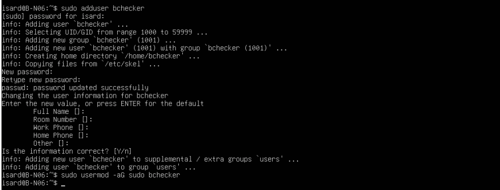

## 2. Configuración de red (Netplan)

Se edita el fichero de Netplan para asignar la IP estática a la interfaz de la Intranet (`enp2s0`). La interfaz `enp1s0` queda en DHCP (salida a Internet para instalar paquetes).

```bash
sudo nano /etc/netplan/50-cloud-init.yaml
```

```yaml
network:
  version: 2
  ethernets:
    enp1s0:
      dhcp4: true
    enp2s0:
      dhcp4: false
      addresses:
        - 10.6.2.10/24
```

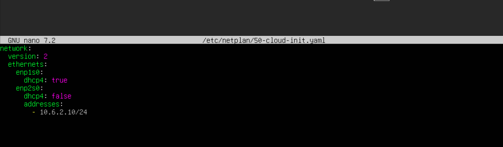

Se aplica la configuración y se comprueba con `ip a`:

```bash
sudo netplan apply
ip a
```

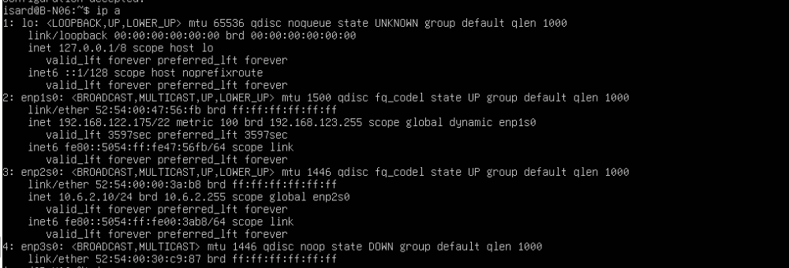

## 3. Instalación de MySQL

```bash
sudo apt update
sudo apt install -y mysql-server
```

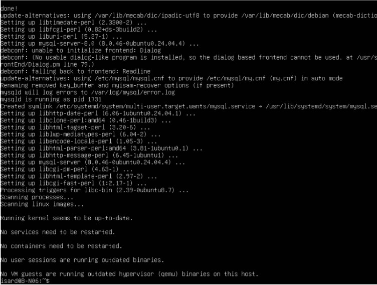

Se habilita el servicio para que arranque con el sistema:

```bash
sudo systemctl enable --now mysql
```

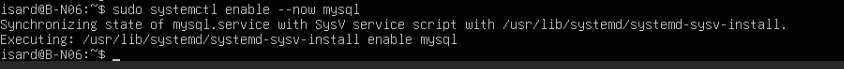

## 4. Acceso remoto a MySQL (`bind-address`)

Por defecto MySQL solo escucha en `127.0.0.1`. Para que el servidor web (`W-N06`, DMZ) pueda conectarse, se hace que escuche en la IP de la Intranet.

```bash
sudo nano /etc/mysql/mysql.conf.d/mysqld.cnf
```

```ini
[mysqld]
bind-address            = 10.6.2.10
mysqlx-bind-address     = 127.0.0.1
```

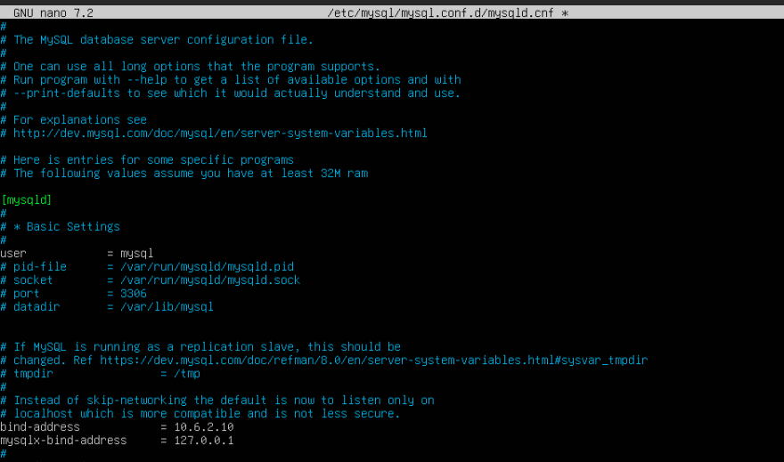

Se reinicia el servicio y se comprueba que el puerto 3306 escucha en la IP correcta:

```bash
sudo systemctl restart mysql
ss -tlnp | grep 3306
```

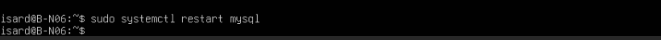
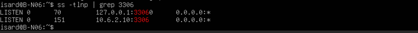

## 5. Instalación de SSH

Se instala el servidor SSH para poder administrar la máquina desde un cliente.

```bash
sudo apt install -y openssh-server
sudo systemctl enable --now ssh
sudo systemctl status ssh
ss -tlnp | grep :22
```

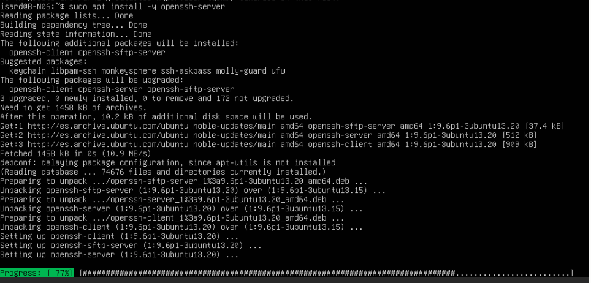
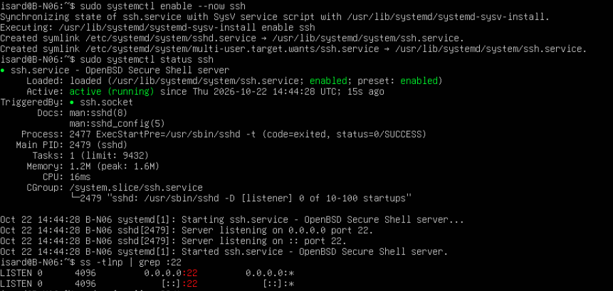

Prueba de conexión desde una máquina cliente:

```bash
ssh isard@10.6.2.10
```

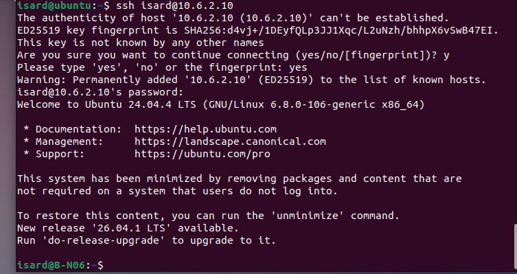

## 6. Descarga y preparación del CSV

### 6.1 Descarga del dataset

Se descarga el CSV de equipamientos desde OpenData Barcelona:

```bash
wget -O /tmp/equipaments.csv "https://opendata-ajuntament.barcelona.cat/data/dataset/f36b60f2-9541-4d08-b0f9-b0a9313fab3d/resource/29d9ff10-6892-4f16-9012-d5c4997857e7/download"
```

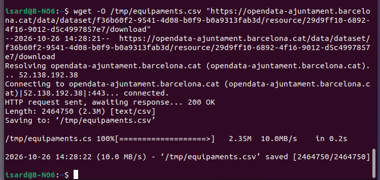

### 6.2 Inspección

```bash
head -3 /tmp/equipaments.csv
file /tmp/equipaments.csv
wc -l /tmp/equipaments.csv
```

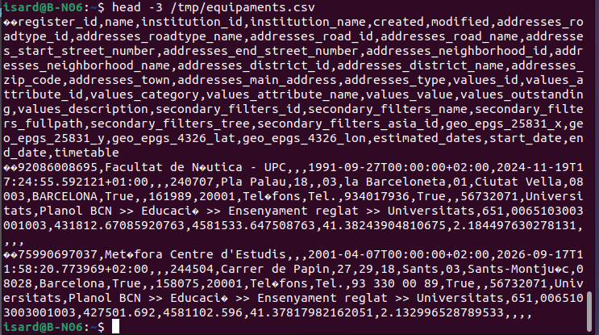

El fichero está en **UTF-16 little-endian** y tiene 2710 líneas (1 cabecera + 2709 registros):

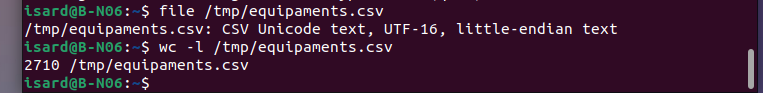

### 6.3 Conversión a UTF-8

MySQL no puede importar UTF-16 con `LOAD DATA`, así que se convierte a UTF-8:

```bash
iconv -f UTF-16LE -t UTF-8 /tmp/equipaments.csv -o /tmp/equipaments_utf8.csv
```

### 6.4 Generación del `CREATE TABLE`

Se usa un script en Python que lee la cabecera del CSV, normaliza los nombres de columna (minúsculas y `_`) y genera el SQL de creación de la tabla. Todas las columnas se definen como `TEXT` para evitar errores de importación.

```bash
python3 - <<'PY'
import csv, re
with open('/tmp/equipaments_utf8.csv', encoding='utf-8') as f:
    header = next(csv.reader(f))      # si es ';' -> csv.reader(f, delimiter=';')
cols = [re.sub(r'\W+', '_', h.strip()).lower() for h in header]
sql = "CREATE TABLE equipaments (\n  id INT AUTO_INCREMENT PRIMARY KEY,\n"
sql += ",\n".join(f"  `{c}` TEXT" for c in cols)
sql += "\n) CHARACTER SET utf8mb4;"
open('/tmp/create_table.sql','w').write(sql)
print(sql)
print("\nColumnas para LOAD DATA:\n(" + ", ".join(f"`{c}`" for c in cols) + ")")
PY
```

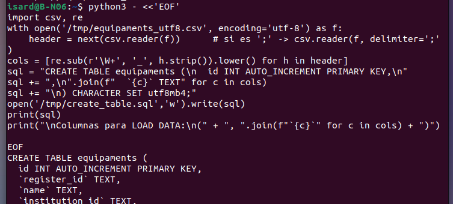

### 6.5 Copia al directorio permitido por MySQL

`LOAD DATA INFILE` solo lee de `secure_file_priv` (`/var/lib/mysql-files/`):

```bash
sudo cp /tmp/equipaments_utf8.csv /var/lib/mysql-files/equipaments.csv
sudo chown mysql:mysql /var/lib/mysql-files/equipaments.csv
```

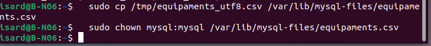

## 7. Base de datos, usuarios y permisos

```bash
sudo mysql
```

```sql
CREATE DATABASE equipaments_db CHARACTER SET utf8mb4 COLLATE utf8mb4_unicode_ci;

-- Usuario de la aplicación web: solo lectura y solo desde W-N06
CREATE USER 'webuser'@'10.6.1.10' IDENTIFIED BY 'WebUser_N06!';
GRANT SELECT ON equipaments_db.* TO 'webuser'@'10.6.1.10';

-- Usuario de comprobación (bchecker): control total sobre la BD
CREATE USER 'bchecker'@'%' IDENTIFIED BY 'bchecker121';
GRANT ALL ON equipaments_db.* TO 'bchecker'@'%';

FLUSH PRIVILEGES;
USE equipaments_db;
```

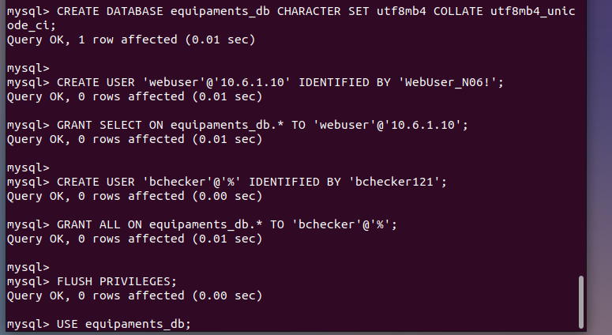

| Usuario | Host permitido | Permisos | Uso |
|---|---|---|---|
| `webuser` | `10.6.1.10` (W-N06) | `SELECT` | Aplicación PHP |
| `bchecker` | `%` | `ALL` sobre `equipaments_db` | Comprobación / administración |

## 8. Creación de la tabla e importación

Se ejecuta el SQL generado:

```bash
sudo mysql equipaments_db < /tmp/create_table.sql
```


La tabla generada ya incluye una columna `id`, que hacía que el número de columnas no coincidiera con el CSV. Por ello, se elimina `id`, se importa y después se vuelve a añadir como clave primaria:

```sql
ALTER TABLE equipaments DROP COLUMN id;

LOAD DATA INFILE '/var/lib/mysql-files/equipaments.csv'
INTO TABLE equipaments
CHARACTER SET utf8mb4
FIELDS TERMINATED BY ',' OPTIONALLY ENCLOSED BY '"'
LINES TERMINATED BY '\n'
IGNORE 1 LINES;

ALTER TABLE equipaments ADD COLUMN id INT AUTO_INCREMENT PRIMARY KEY FIRST;
```

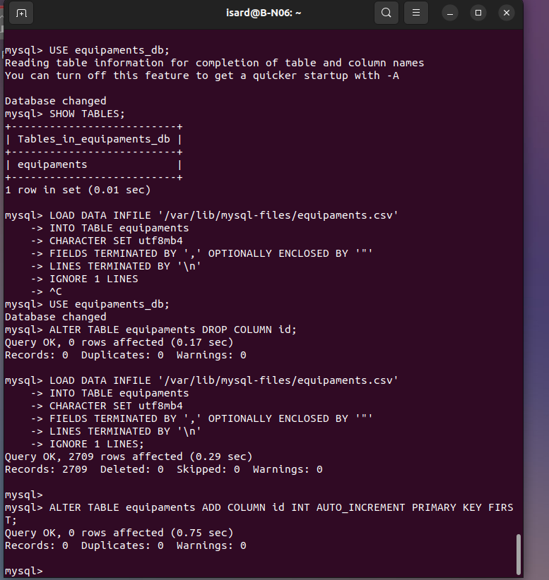

Resultado: **2709 filas importadas**, 0 omitidas, 0 avisos.

## 9. Firewall (UFW)

Se instala UFW y se aplica una política restrictiva: se deniega todo el tráfico entrante salvo SSH y MySQL desde el servidor web.

```bash
sudo apt install -y ufw
sudo ufw default deny incoming
sudo ufw default allow outgoing
sudo ufw allow 22/tcp
sudo ufw allow from 10.6.1.10 to any port 3306 proto tcp
sudo ufw show added
sudo ufw enable
sudo ufw status
```

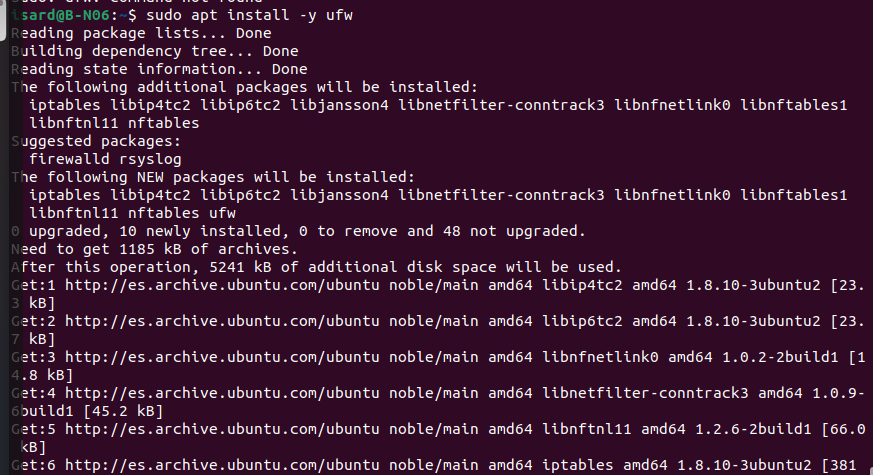
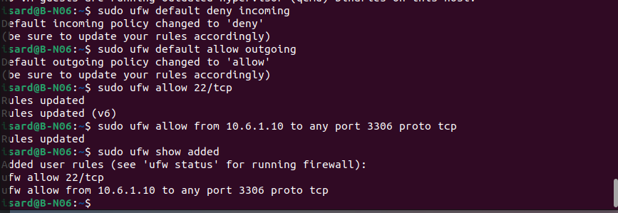
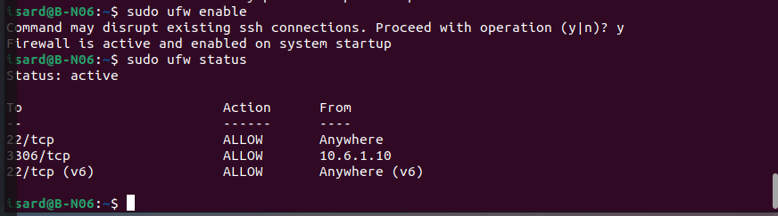

| Puerto | Protocolo | Origen | Motivo |
|---|---|---|---|
| 22 | TCP | Cualquiera | Administración SSH |
| 3306 | TCP | `10.6.1.10` | MySQL solo desde `W-N06` |

## 10. Reglas de reenvío en el router

Para que `W-N06` (DMZ) llegue a `B-N06` (Intranet) a través del router, deben existir estas reglas en `FORWARD` de **`R-N06`**:

```bash
sudo iptables -A FORWARD -s 10.6.1.10 -d 10.6.2.10 -p tcp --dport 3306 -j ACCEPT
sudo iptables -A FORWARD -m state --state ESTABLISHED,RELATED -j ACCEPT
```

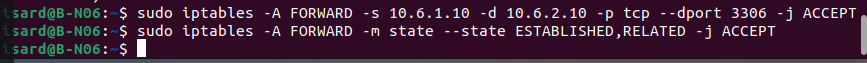

> Estas reglas se aplican en el router (ver [Netplan, NAT y Firewall](../01-r-n06/01-red-firewall.md)).

## 11. Verificación final

```sql
SELECT COUNT(*) FROM equipaments;
DESCRIBE equipaments;
SELECT * FROM equipaments LIMIT 1\G
```

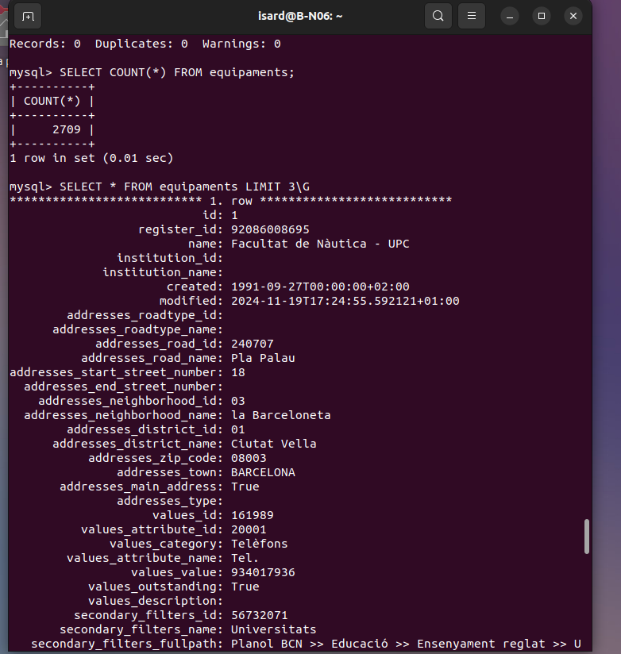
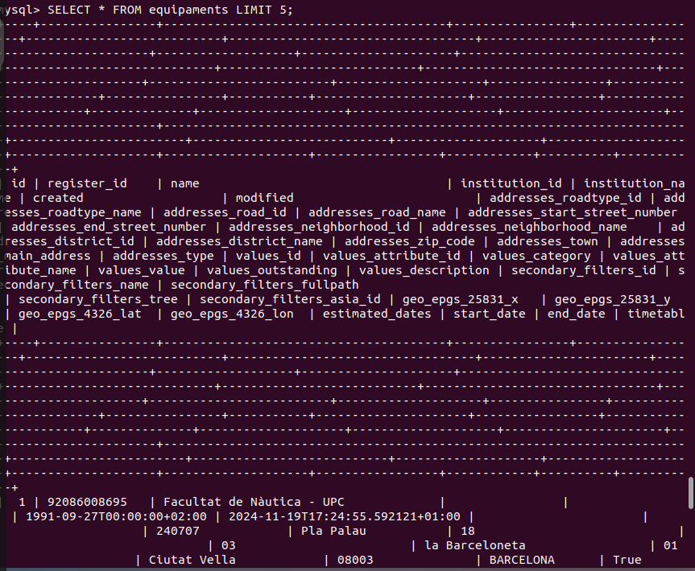

Comprobación desde el servidor web (`W-N06`):

```bash
mysql -h 10.6.2.10 -u webuser -p equipaments_db -e "SELECT COUNT(*) FROM equipaments;"
```

Debe devolver **2709**.

---

## Resumen de ficheros y comandos clave

| Elemento | Ruta / valor |
|---|---|
| Netplan | `/etc/netplan/50-cloud-init.yaml` |
| Config MySQL | `/etc/mysql/mysql.conf.d/mysqld.cnf` |
| CSV importado | `/var/lib/mysql-files/equipaments.csv` |
| Base de datos | `equipaments_db` |
| Tabla | `equipaments` (2709 registros) |
| Puerto MySQL | `3306/tcp` en `10.6.2.10` |
